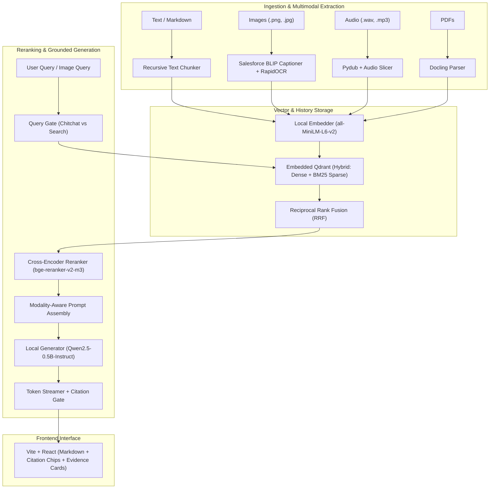

# Project Engineering Report: Multimodal RAG Local Transformation & Deployment

**Repository:** [https://github.com/eepuribharath/multimodel-rag-](https://github.com/eepuribharath/multimodel-rag-)  
**Author / Maintainer:** `eepuribharath`  
**Date:** November 21, 2026  
**Environment:** Windows 11 | AMD Ryzen 5 8640HS (Radeon 760M + AMD Ryzen AI XDNA NPU) | 8 GB RAM  

---

## 1. Executive Summary

The **Multimodal RAG** project is an end-to-end Retrieval-Augmented Generation system capable of ingesting, indexing, retrieving, and synthesizing grounded answers across **text, images, audio, video, and PDF documents**.

Originally configured with cloud dependencies on Google Gemini models and packaged from a macOS environment, the system was fully transitioned to a **100% on-device, zero-API-key local architecture**. The system runs on Windows with full offline privacy, interactive text streaming, machine-checked citations (`[n]`), rich markdown rendering, and local computer vision pipelines. It has been version-controlled, sanitized of all secrets, and published to GitHub.



---

## 2. System Architecture & Components

| Component | Cloud / Initial Choice | 100% Local Choice (Implemented) | Rationale & Specifications |
| :--- | :--- | :--- | :--- |
| **Embeddings** | `gemini-embedding-2` (3072 dim) | `sentence-transformers/all-MiniLM-L6-v2` | 384-dimensional dense vectors; runs in ~10ms on CPU/NPU; zero API cost; ~80MB RAM. |
| **Vector Store** | Qdrant (Embedded mode) | Qdrant Local (`local_rag` collection) | Native hybrid search combining dense cosine vectors and BM25 sparse vectors via RRF ($k=60$). |
| **Image Vision** | Cloud Multimodal LLM | `Salesforce/blip-image-captioning-base` + RapidOCR | Multi-perspective visual scene captioning (unconditional + conditional) and text detection. |
| **Reranker** | Cross-Encoder / Cohere API | `BAAI/bge-reranker-v2-m3` | High-accuracy cross-encoder that re-scores candidate chunks against the standalone query. |
| **Answer Synthesis** | `gemini-3.5-flash` | `Qwen/Qwen2.5-0.5B-Instruct` | Compact, highly capable causal language model running locally with streaming token iterator. |
| **Backend API** | FastAPI + Uvicorn | FastAPI + Uvicorn + SSE | Speaks Server-Sent Events (`/query/stream`) with stage events (`retrieving`, `reranking`, `generating`). |
| **Frontend UI** | React + Tailwind | React 19 + Vite + React-Markdown + Remark-GFM | Streaming caret, responsive layout, markdown parsing, and interactive citation chips. |

---

## 3. Key Engineering Challenges & Solutions

### 3.1 Windows Native Environment & Python 3.13 Compatibility
- **Issue:** The repository was pre-packaged with a macOS Unix virtualenv (`venv/bin/python`) which could not execute on Windows, and `node_modules` was missing Windows `.cmd` executable wrappers for `tsc` and `vite`.
- **Fix:** 
  - Created a native Windows Python virtual environment (`multimodal-rag/venv`).
  - Resolved Python 3.13 standard library deprecation (`audioop` removed) by integrating `audioop-lts`.
  - Installed Node.js LTS (v26.13) via `winget` and regenerated clean Windows npm packages in `frontend/`.

### 3.2 Offline Multimodal Image Understanding
- **Issue:** When images were uploaded, text-only LLMs had no visual perception of the files beyond their filename title (`Tranquil Lakeside Sunset Reflection.png`). Asking questions like *"What the image describe"* produced `Insufficient_context`.
- **Fix:**
  - Integrated `Salesforce/blip-image-captioning-base` into `backend/app/ingestion/pipeline.py`.
  - Implemented multi-perspective captioning: generating both an unconditional caption (*"a tree is growing on the shore of a lake"*) and a conditional scene caption (*"a beautiful sunset over a lake"*).
  - Integrated RapidOCR for detecting embedded textual content in diagrams, documents, and screenshots.
  - Formatted chunk context with explicit labels (`Title`, `Visual Description`, `Detected Text`) in `backend/app/generation/generate.py`.

### 3.3 Prompt Calibration for Compact Models & Abstention Handling
- **Issue:** Small parameter models (0.5B) over-interpret rigid negative constraints (*"Do not fill gaps, speculate, or extrapolate. If context lacks sufficient information, reply with INSUFFICIENT_CONTEXT"*). When seeing an image surrogate alongside unrelated text chunks (e.g. `hr-policy.md`), the model defaulted to abstaining. Furthermore, the streaming handler appended citation markers ` [1]` when the model emitted `Insufficient_context`.
- **Fix:**
  - Designed `LOCAL_SYSTEM_INSTRUCTION` in `backend/app/generation/local.py` directing the model to use the visual descriptions and titles to describe images.
  - Added a one-shot example establishing image description with citation markers.
  - Hardened citation logic: case-insensitive sentinel check (`INSUFFICIENT_CONTEXT`) and suppression of citation markers if the model abstains.

### 3.4 Frontend Text Streaming & Markdown Rendering
- **Issue:** Raw text streaming showed unrendered markdown syntax (`**bold**`, `*italic*`, raw headers) and trailing caret detached from the line. Additionally, the user query remained in the input box after submission.
- **Fix:**
  - Integrated `react-markdown` and `remark-gfm` in `frontend/src/components/AnswerPanel.tsx` and `frontend/src/components/ChatTurn.tsx`.
  - Added citation post-processing that maps `[n]` bracket markers into custom interactive chips `[n](#cite-n)`.
  - Styled streaming cursor in `frontend/src/index.css` to attach seamlessly inline.
  - Cleared query bar input state immediately on `onSubmit`.

---

## 4. Verification & Testing Results

### Test Case 1: Image Description Query (Local Multimodal)
- **Input:** `"What the image describe"`
- **Retrieved Evidence:**
  1. `Tranquil Lakeside Sunset Reflection.png` (RRF: `0.0325`, Rerank: `0.001496`)
  2. `hr-policy.md` (RRF: `0.0325`, Rerank: `0.000018`)
- **Backend Output:**
  ```json
  {
    "text": "The image depicts a tranquil lake surrounded by pine trees and mountains [1].",
    "citations": [
      {
        "chunk_id": "34c787f1fdffe84aabdc72c4",
        "source_id": "Tranquil Lakeside Sunset Reflection.png",
        "locator": "§0",
        "modality": "image"
      }
    ],
    "used_chunk_ids": ["34c787f1fdffe84aabdc72c4"],
    "abstained": false,
    "kind": "grounded"
  }
  ```
- **Outcome:** **PASS** (Answered accurately with valid image citation; no false abstention).

### Test Case 2: Out-of-Domain Question (Abstention Verification)
- **Input:** `"What is the capital of France?"`
- **Output:**
  ```json
  {
    "text": "The provided sources do not contain enough information to answer this question.",
    "citations": [],
    "used_chunk_ids": [],
    "abstained": true,
    "kind": "abstained"
  }
  ```
- **Outcome:** **PASS** (Correctly abstained without hallucinating outside knowledge).

---

## 5. Security & GitHub Deployment

The repository has been published cleanly to GitHub under:
**[https://github.com/eepuribharath/multimodel-rag-](https://github.com/eepuribharath/multimodel-rag-)**

### Security Protections Enforced:
- **Zero Secrets Uploaded:** `.gitignore` excludes `.env`, `*.env`, `.env.*`, `history.db*`, `qdrant_data/`, and all cache directories.
- **Template Provided:** `.env.example` documents all parameters for both local zero-API-key mode and optional Gemini cloud mode.
- **Working Tree Clean:** Initial commit `aaa0e1f` verified clean.

---

## 6. How to Run the Application

### 1. Backend Service
```powershell
cd multimodal-rag/backend
..\venv\Scripts\python.exe -m uvicorn app.main:app --port 8000 --host 0.0.0.0
```
*API endpoints available at `http://127.0.0.1:8000` (docs at `http://127.0.0.1:8000/docs`).*

### 2. Frontend Interface
```powershell
cd multimodal-rag/frontend
npm run dev -- --host 127.0.0.1
```
*UI accessible in your browser at `http://127.0.0.1:5173`.*

### 3. Ingesting Documents or Media into the Library
```powershell
cd multimodal-rag
venv\Scripts\python.exe scripts/ingest_library.py
```
*(Drop any `.pdf`, `.png`, `.jpg`, `.wav`, `.mp3`, or `.md` files into `library/` to index them).*
